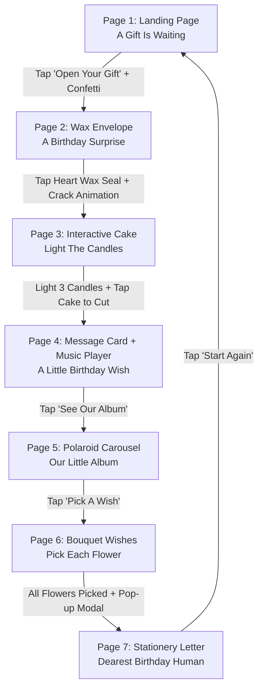

# 🎂 Comprehensive Development Specification: Interactive Birthday Surprise Website

> **Based on Frame-by-Frame Video Analysis of `Screen Recording 2026-10-25 180523.mp4`**  
> **Target Date:** 29th of this month  
> **Goal:** High-end, funny, cute, aesthetic, and premium interactive friendship gift website.

---

## 📑 Table of Contents
1. [Architecture & Screen Flow Diagram](#1-architecture--screen-flow-diagram)
2. [Global Design System & Aesthetics](#2-global-design-system--aesthetics)
3. [Page 1: Welcome & Landing ("A Gift is Waiting")](#3-page-1-welcome--landing-a-gift-is-waiting)
4. [Page 2: The Sealed Surprise Envelope ("A Birthday Surprise")](#4-page-2-the-sealed-surprise-envelope-a-birthday-surprise)
5. [Page 3: Interactive Birthday Cake ("Light the Candles")](#5-page-3-interactive-birthday-cake-light-the-candles)
6. [Page 4: Birthday Message & Music Player ("A Little Birthday Wish")](#6-page-4-birthday-message--music-player-a-little-birthday-wish)
7. [Page 5: Polaroid Memory Album ("Our Little Album")](#7-page-5-polaroid-memory-album-our-little-album)
8. [Page 6: Interactive Bouquet ("A Tiny Bouquet of Birthday Wishes")](#8-page-6-interactive-bouquet-a-tiny-bouquet-of-birthday-wishes)
9. [Page 7: The Grand Stationery Letter ("Dearest Birthday Human")](#9-page-7-the-grand-stationery-letter-dearest-birthday-human)
10. [Dynamic State Machine & Audio Engine](#10-dynamic-state-machine--audio-engine)
11. [Developer Implementation Plan & Code Architecture](#11-developer-implementation-plan--code-architecture)

---

## 1. Architecture & Screen Flow Diagram



---

## 2. Global Design System & Aesthetics

### 2.1 Color Palette
The website uses a dreamy, high-end pastel aesthetic with glassmorphism:
* **Background Gradient:** Smooth multi-stop pastel mesh:
  * Soft Peach: `#FFE5D9`
  * Lavender Haze: `#E8DFF5`
  * Pale Blush Rose: `#FCE1E4`
  * Warm Cream: `#FCF6BD`
  * Soft Lilac: `#D0BCFE`
* **Card Surface:** `#FFFFFF` with `rgba(255, 255, 255, 0.88)` and `backdrop-filter: blur(16px)`.
* **Primary Accent Pink:** `#FF6B8B` / `#E85D75` (Button gradients and highlights).
* **Text Colors:**
  * Primary Headings: Deep Mulberry / Plum `#3D2645` or Deep Warm Espresso `#2C2030`.
  * Secondary / Subtitles: Muted Rose-Mauve `#83677B` or Warm Dusty Purple `#6C5868`.
  * Accent Sparkles / Wax: Rosy Crimson `#D94E67` and Warm Gold `#F4A261`.

### 2.2 Typography Hierarchy
* **Display / Serifs (Headings):** Elegant, editorial serif with italic flourishes (e.g., `Playfair Display`, `Cormorant Garamond`, or `Recoleta`).
* **UI & Navigation:** Modern, rounded geometric sans-serif (e.g., `Outfit`, `Plus Jakarta Sans`, or `Quicksand`).
* **Letter / Note Body:** Warm, human-crafted readable serif or soft sans (`Lora`, `Newsreader`, or `Caveat` for handwritten touches).

### 2.3 Atmospheric Particle Layer
* **Canvas Particles:** Continually floating in the background across all pages:
  * Soft circular confetti dots (pastel pink, lilac, peach, baby blue).
  * Drifting sakura / flower petal outlines rotating gently.
  * Subtle twinkling 4-point golden/white sparkles.

---

## 3. Page 1: Welcome & Landing ("A Gift is Waiting")

### Visual Structure & Placement
* **Top Pill Badge:**
  * Content: `💌 A GIFT IS WAITING`
  * Style: White frosted capsule, subtle pink border, miniature heart icon, letter-spaced uppercase text.
* **Header Block:**
  * Title: `Happy Birthday` (Large editorial serif, deep plum `#3D2645`).
  * Subtitle: `someone made you something ♡` (Gentle italic font, dusty mauve `#83677B`).
* **Hero Mascot Animation:**
  * Graphic: Cute animated bouncing chibi creature/piglet with rosy cheeks, wiggling floppy ears, and an excited expression.
  * Motion: Soft vertical floating bounce with drop-shadow squash-and-stretch.
* **Interactive CTA Button:**
  * Label: `🎁 OPEN YOUR GIFT`
  * Styling: Glossy pill button with pink gradient (`linear-gradient(135deg, #FF758C 0%, #FF7EB3 100%)`), white drop shadow, and continuous soft pulsing glow.
  * Micro-interaction: Hover scales up to `1.05`; on-click produces an expansive confetti shower and fluid fade-out transition.

---

## 4. Page 2: The Sealed Surprise Envelope ("A Birthday Surprise")

### Visual Structure & Placement
* **Top Pill Badge:** `💌 A BIRTHDAY SURPRISE`
* **Header Block:**
  * Title: `a little something for you` (Lowercase serif).
  * Subtitle: `happy birthday ♡` (Muted mauve italic).
* **Companion Mascot:**
  * Cute kitten/bunny sitting atop the envelope, with floating hearts drifting upward in a looping animation.
* **Interactive Wax-Sealed Envelope:**
  * Envelope flap: Classic triangular envelope fold in soft cream/ivory `#FFFDF9`.
  * Wax Seal: Circular 3D wax seal medallion in berry-pink `#D94E67` embossed with a heart imprint.
  * Helper Prompt: `TAP THE SEAL TO OPEN ✦` with subtle bounce animation.
* **Interaction Logic:**
  * Clicking the wax seal triggers:
    1. A visual wax seal burst/break effect with mini sparkles.
    2. Envelope flap rotates open 180° along the X-axis (`transform: rotateX(180deg)`).
    3. Smooth camera zoom and screen fade-out into Page 3.

---

## 5. Page 3: Interactive Birthday Cake ("Light the Candles")

### Visual Structure & Placement
* **Top Pill Badge:** `🎂 MAKE A WISH`
* **Title:** `light the candles`
* **Cake Component:**
  * A 3-tiered illustrated celebration cake:
    * Bottom tier: Soft lavender with white dripping icing.
    * Middle tier: Pastel strawberry pink with dripping icing.
    * Top tier: Vanilla cream with decorative dollops.
  * Top of Cake: 3 vertical candy-striped candle sticks.
  * Initial State: All 3 candle wicks are unlit.
* **Interactive Candle Triggers:**
  * 3 buttons arranged in a horizontal row below the cake:
    * `[ CANDLE 1 ]`, `[ CANDLE 2 ]`, `[ CANDLE 3 ]`.
  * Initial helper prompt: `tap each candle to light it up` with 3 progress dots.
* **Interaction Sequence:**
  1. Clicking `[ CANDLE 1 ]` ignites a flickering flame over candle 1; button transforms to active pink: `✦ LIT`.
  2. Clicking `[ CANDLE 2 ]` ignites flame 2; button becomes `✦ LIT`.
  3. Clicking `[ CANDLE 3 ]` ignites flame 3; button becomes `✦ LIT`.
  4. Once all 3 are lit:
     * Helper text dynamically pulses to: `now tap the cake to cut it! 🎂`
     * A cursor pointer or subtle bounce draws attention to the cake.
  5. User taps the cake:
     * A slice cut animation activates (cake visually splits down the center).
     * Confetti shoots out.
     * Title changes smoothly to: `wish made ♡`.
     * Sub-text updates to: `may every single one of them come true this year.`
     * Automatically transitions smoothly to Page 4 after a 2-second celebration pause.

---

## 6. Page 4: Birthday Message & Music Player ("A Little Birthday Wish")

### Visual Structure & Placement
* **Card Container:**
  * Floating frosted card with rounded corners (`32px`), thin pink border, and delicate floral sticker ornaments at the corners.
  * Avatar badge: Circular medallion overlapping the top-right corner with the cute mascot waving inside.
* **Top Pill Badge:** `✨ A LITTLE BIRTHDAY WISH ✨`
* **Heading:** `Happy Birthday`
* **Heartfelt Message Paragraph:**
  > *"Today is yours. A whole little garden of wishes — for every laugh we've shared, every silly moment, and every reason you make the world brighter. Pause for a beat, and let me say it properly."*
* **Embedded Interactive Music Player:**
  * Album Thumbnail: Pastel floral vinyl cover.
  * Track Title: `A song for your day`
  * Sub-label: `WITH LOVE`
  * Controls:
    * Circular pink play/pause button (toggles play state with audio playback).
    * Dynamic progress bar with drag/seek capability.
    * Time counters: `0:00` / `0:45` (plays the warm birthday song seen in the recording: *"Saal bhar mein sabse pyara..."*).
  * Footnote: `press play — i picked this one because it always reminds me of you.`
* **CTA Button:** `SEE OUR ALBUM ➔` (Advances to Page 5).

---

## 7. Page 5: Polaroid Memory Album ("Our Little Album")

### Visual Structure & Placement
* **Header Block:**
  * Title: `our little album`
  * Subtitle: `a few of my favourite moments with you ♡`
* **Polaroid Card Component:**
  * True-to-life Polaroid photo frame:
    * Translucent decorative washi tape on the top edge.
    * Subtle corner angle tilt (`-1.5deg` to `1.5deg`).
    * Drop shadow with realistic photo paper texture.
* **Photo Carousel Data:**
  * **Photo 1:** Cute Hamster holding a mini cake with a single candle.
    * Tag: `MEMORY 01 / 03`
    * Description: *"the way you smile in every photo — i hope you know it lights up the room."*
  * **Photo 2:** Cartoon friends sharing cake under a banner `HAPPY BIRTHDAY`.
    * Tag: `MEMORY 02 / 03`
    * Description: *"ordinary days with you have always been my favourite ones."*
  * **Photo 3:** Cute celebratory animated doodle dancing joyfully with confetti.
    * Tag: `MEMORY 03 / 03`
    * Description: *"thank you for showing up — for everything, every time."*
* **Carousel Controls:**
  * Circular navigation buttons on left (`<`) and right (`>`).
  * Smooth card flip / sliding fade transition between photos.
* **CTA Button:** `PICK A WISH ➔` (Advances to Page 6).

---

## 8. Page 6: Interactive Bouquet ("A Tiny Bouquet of Birthday Wishes")

### Visual Structure & Placement
* **Header Block:**
  * Title: `a tiny bouquet of birthday wishes`
  * Subtitle: `pick each flower — there's a little wish inside ♡`
* **Bouquet Setup:**
  * 3 vertical flower wish cards standing upright side-by-side.
  * A translucent pastel pink ceramic vase positioned at the bottom holding the stems.
* **3 Flower Cards:**
  1. **Flower 1 (Rose/Dahlia):**
     * Front: Delicate pink blossom icon + `PICK ME` button.
     * Back / Revealed:
       * Title: `✦ THE WAY YOU LAUGH`
       * Text: *"your laugh is one of those sounds that just makes a room feel warmer. wishing you a year full of the kind of moments that bring it out again and again."*
  2. **Flower 2 (Daisy/Sunflower):**
     * Front: Warm peach daisy icon + `PICK ME` button.
     * Back / Revealed:
       * Title: `✦ THE WAY YOU SHOW UP`
       * Text: *"you remember the small things — the worry from a Tuesday, the random text on a hard day. it always feels like being seen, not just heard. wishing you the same softness back this year."*
  3. **Flower 3 (Aster/Lavender):**
     * Front: Lavender purple aster icon + `PICK ME` button.
     * Back / Revealed:
       * Title: `✦ THE YEAR AHEAD`
       * Text: *"may this year be kinder than the last. may every new chapter bring you good food, better naps, and people who love you the way you deserve."*
* **Bouquet Completion Modal:**
  * Once all 3 flowers have been tapped and revealed, a celebratory modal smoothly overlays:
    * Mascot avatar: Two sleepy cuddled kittens with floating heart.
    * Heading: `happy birthday ♡`
    * Letter preview: *"thank you for being you — for the patience, the late-night talks, the silly inside jokes. i hope today feels as gentle and special as you've always made my days feel."*
    * Button: `READ MY LETTER ➔` (Opens Page 7).

---

## 9. Page 7: The Grand Stationery Letter ("Dearest Birthday Human")

### Visual Structure & Placement
* **Letter Stationery Sheet:**
  * Soft cream parchment note paper with faint horizontal ruled lines and washi tape pins at top corners.
  * Top emblem: Happy mascot piglet avatar inside a pink roundel.
* **Top Pill Badge:** `✦ A LETTER, JUST FOR YOU ✦`
* **Salutation:** `Dearest birthday human,` (Warm serif font).
* **Letter Body Content:**
  * **Paragraph 1:**  
    *"there's no card big enough for everything i'd like to say, so i made you a little garden — with a song, our pictures, and a few of my favourite wishes for the year ahead."*
  * **Paragraph 2:**  
    *"thank you for the small and unseen things — the way you check in, the jokes only we get, the quiet patience when i'm being too much. i noticed. i still notice."*
  * **Paragraph 3:**  
    *"i hope today you feel celebrated. i hope you eat something delicious that you didn't have to make, and someone tells you you're loved (you are). most of all, i hope this year ahead feels — for one whole trip around the sun — exactly the way you've always made me feel: completely, completely loved."*
* **Divider & Sign-off:**
  * Dotted divider with a mini heart glyph.
  * Sign-off:
    `♡ with all my love,`  
    `— YOUR FRIEND`
* **Loop / Restart Action:**
  * Button: `✨ START AGAIN`
  * Action: Resets the state machine cleanly and navigates back to Page 1 so the experience can be relived.

---

## 10. Dynamic State Machine & Audio Engine

### State Management
```javascript
const AppState = {
  currentPage: 1, // 1 to 7
  candlesLit: { 1: false, 2: false, 3: false },
  cakeCut: false,
  musicPlaying: false,
  currentMemoryIndex: 0,
  flowersRevealed: { 1: false, 2: false, 3: false },
  bouquetModalVisible: false
};
```

### Audio Triggers
1. **Button Pop / Click Sound:** Gentle acoustic pop on button clicks.
2. **Wax Seal Crack Sound:** Crisp seal crack / page flip effect.
3. **Candle Strike Sound:** Match lighting sound effect when candles ignite.
4. **Cake Slice Sound:** Celebratory party horn / chime.
5. **Background Music:** Integrated HTML5 `<audio>` element with play, pause, progress bar updates, and loop control.

---

## 11. Developer Implementation Plan & Code Architecture

| Step | Component / Task | Details |
|---|---|---|
| **1** | **Base Scaffold & Canvas Engine** | `index.html`, `style.css`, and a floating particle canvas running smoothly in the background. |
| **2** | **Design System & CSS Tokens** | Custom variables for gradients, fonts, shadows, washi tape styles, and glassmorphism. |
| **3** | **Interactive Page Router** | Zero-dependency smooth page transition engine (`fade-in`, `slide-up`, `scale`). |
| **4** | **Page 1 & 2 Modules** | Bouncing mascot, pulse button, 3D wax seal and envelope opening animation. |
| **5** | **Page 3 (Cake Engine)** | SVG/CSS layered cake with candle fire flicker animations and slice-cutting split logic. |
| **6** | **Page 4 (Audio Player)** | Functional audio player with play/pause, seek scrub, and formatted message card. |
| **7** | **Page 5 (Polaroid Carousel)** | Smooth sliding carousel with previous/next buttons and memory counter. |
| **8** | **Page 6 (Flower Bouquet)** | 3D card flip/expand logic, completion detection, and modal reveal. |
| **9** | **Page 7 (Grand Letter)** | Lined stationery paper rendering, decorative pins, and restart loop. |
| **10** | **Customizer Config (`config.js`)** | Centralized configuration for friend's name, custom photos, audio file, and custom letter text. |
